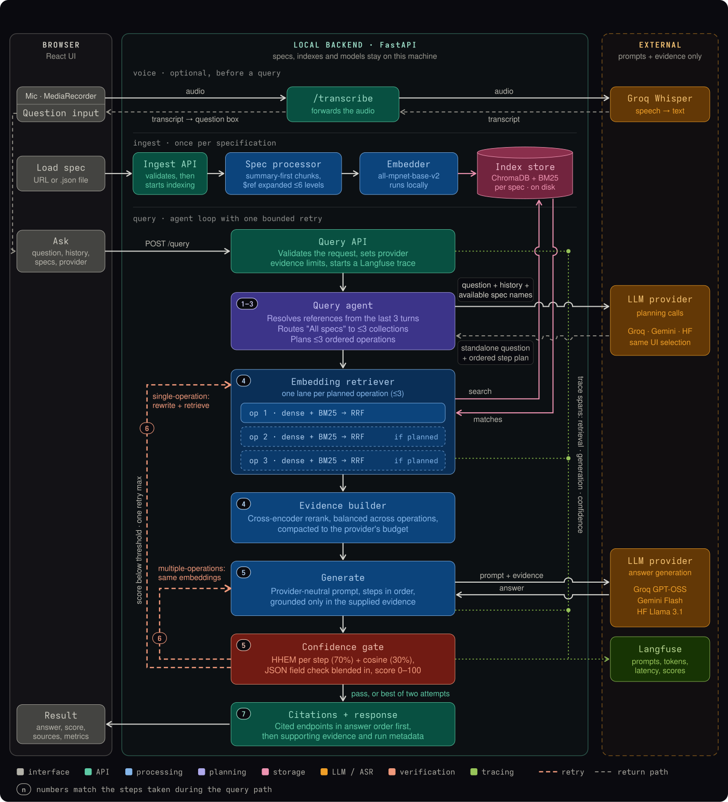

# DocQuery 🔍

**Ask multi-step questions across OpenAPI specifications with an agentic, source-grounded RAG pipeline.**

---


---

https://github.com/user-attachments/assets/84bf04d7-2583-4fc6-b5a4-e2d8bdf2a7c2

## Why This Project Matters

The standard advice for understanding an API is "just paste the spec into ChatGPT." That breaks down fast.

| Problem | DocQuery's Solution |
|---|---|
| Stripe's spec is ~50,000 lines - won't fit in any context window | RAG retrieves only the relevant chunks per query |
| Whole specifications are too large or sensitive to send on every request | Specs are indexed locally; the selected LLM receives bounded evidence and question/planning context, including recent history or specification names when needed |
| LLM training data has a cutoff - new endpoints are unknown | Re-ingest any time, answers always reflect the current spec |
| Raw LLM answers can't cite where they got the answer | Every response includes the exact source endpoints |
| Can't query multiple APIs simultaneously | Multi-spec support with per-spec ChromaDB collections |
| Compound tasks collapse onto one likely endpoint | The agent decomposes workflows and balances evidence across every planned operation |
| A plausible answer can still be incomplete | Step-aware confidence scores each workflow step against its own evidence and permits one bounded retry |

---

## Features

- **RAG pipeline** - OpenAPI spec is chunked, embedded with `all-mpnet-base-v2`, and stored in ChromaDB alongside a BM25 index built from tokenized chunk text; each query runs dense and keyword retrieval, fuses them with Reciprocal Rank Fusion (RRF), then re-ranks candidates with a cross-encoder before hitting the LLM.
- **`$ref` resolution** - request body schemas are fully dereferenced at ingest time, including `allOf`, `anyOf`, and `oneOf` composition patterns (up to 6 levels deep), so field names like `name` are semantically searchable.
- **Confidence scoring** - 70% judge score + 30% cosine similarity. The judge itself blends Vectara's HHEM hallucination score (70%) with JSON field grounding (30%). Falls back to cosine-only if HHEM scoring fails.
- **Source citations** - every answer includes the exact HTTP method + path that grounded it; endpoints cited in the final answer appear first in workflow order, followed by supporting retrieval evidence.
- **Multi-spec support** - ingest multiple APIs simultaneously and switch between them with one click
- **Dual ingest modes** - paste a public URL or upload a local `.json` file (for private/internal specs)
- **Persistent vector store** - ChromaDB and BM25 indexes persist to disk; specs survive restarts without re-ingestion.
- **Voice input** - record a question via the browser's MediaRecorder API; audio is transcribed by Whisper via Groq (~1s) and populated into the query box automatically.
- **Pipeline observability** - every query is traced end-to-end with Langfuse; retrieval span logs which endpoints were retrieved, the LLM generation span logs the full prompt and answer, and confidence scores are tracked as metrics across all queries.
- **LangGraph orchestration** - the full query lifecycle runs as a compiled `StateGraph`, with typed request state and confidence-driven conditional edges for bounded regeneration or rewrite-and-retrieval.
- **Confidence-gated self-correction** - when an answer scores below the grounding threshold, the agent makes one bounded retry and keeps the better-grounded attempt. Workflow retries preserve the balanced evidence set; single-operation retries may rewrite and retrieve again.
- **Workflow-aware answers** - compound questions are decomposed into at most three focused operations; evidence is labelled per operation, exact action matches are prioritized, and the answer must cover every step in order. Missing steps reduce confidence and trigger correction.
- **Workflow-aware confidence** - each answer step is scored only against the evidence retrieved for its corresponding operation; missing steps or missing labelled evidence contribute zero instead of letting unrelated chunks inflate the score.
- **Conversational follow-ups** - the browser sends the last three successful exchanges to resolve references such as "that endpoint" into standalone retrieval questions; the backend keeps no persistent conversation memory, and browser history resets when switching specifications. Provider calls and configured tracing can contain this context.
- **Cross-spec queries** - an "All specifications" mode routes questions to at most three relevant API collections, combines their evidence, and labels every cited endpoint with its source specification.

---

## Architecture



The query path is a compiled LangGraph `StateGraph` rather than a single retrieve-and-generate call:

1. Resolve conversational references using up to three client-supplied history turns.
2. Route `All specifications` questions to at most three relevant local collections.
3. Decompose compound questions into at most three ordered operations.
4. Retrieve and balance hybrid evidence per operation, then compact it to the selected provider's budget.
5. Generate with Groq, Gemini, or Hugging Face and score each answer step only against its labelled evidence group.
6. Let the confidence node choose a conditional edge: finalize when the threshold is met, regenerate a workflow from the same balanced evidence, or rewrite a single-operation query and retrieve again. Stop after one corrective attempt and retain the higher-scoring result.
7. Return citations reordered to match the endpoints as they appear in the answer, followed by supporting evidence.

Planning uses the selected external LLM: contextualization sends the question and recent history when valid history is present; routing sends the question and available specification names for `All specifications` when more than three collections exist; decomposition sends the resolved question to produce one to three retrieval queries. These are separate calls. With no history, one selected specification, and no retry, the normal path makes two LLM calls: decomposition and answer generation. The response's `agent.resolved_question` and `agent.selected_specs` come from the completed graph state.

The backend keeps indexes locally and does not persist conversation history as application memory. Query evidence and planning context are sent to the selected provider; optional voice input sends recorded audio to Groq Whisper. When Langfuse tracing is enabled, prompts (including retrieved evidence), answers, and run metadata are also sent to the configured Langfuse service.

---

## Design Decisions

**Summary-first chunking** - Each chunk starts with `{summary} - {METHOD} {path}` before the technical details. The sentence transformer sees the human-readable description first, which dramatically improves retrieval for natural language queries over path-only chunking. Synonym expansion is also injected into each chunk so keyword queries hit the right endpoints.

**`$ref` resolution at ingest time** - OpenAPI specs use `$ref` pointers for all request/response schemas. Without resolving them, chunks contain `#/components/schemas/User` instead of the actual field names (`name`, `password`). The resolver handles `allOf`, `anyOf`, and `oneOf` composition up to 6 levels deep, so nested schemas are fully searchable.

**Hybrid BM25 + dense retrieval with RRF** - Dense embeddings capture semantic similarity; BM25 catches exact keyword matches (endpoint paths, parameter names). Reciprocal Rank Fusion combines both ranked lists into a single candidate set without needing a tuned interpolation weight. A cross-encoder then re-ranks the fused top-N for precision before the prompt is built.

**Bounded agent orchestration** - A LangGraph `StateGraph` resolves follow-ups, routes across specifications, and creates a plan of at most three operations before retrieval. Its confidence node conditionally finalizes, regenerates from balanced workflow evidence, or rewrites and returns to retrieval for a single-operation query. The graph is deliberately bounded to one corrective attempt, keeping latency and free-tier usage predictable.

**Provider-aware evidence budgets** - Groq, Gemini, and Hugging Face share the same orchestration path but receive different chunk and character budgets. Oversized schemas are compacted while preserving endpoint identity, required fields, and workflow-linking parameters. This prevents provider payload errors without weakening the plan itself.

**BM25 + RRF over HyDE** - HyDE generates a hypothetical answer to use as a proxy query, which helps when queries are vague and documents are unstructured prose. API documentation is the opposite: queries are specific ("how do I update a customer") and documents are structured chunks with exact method+path identifiers. In that setting HyDE introduces hallucination risk at the retrieval stage - a fabricated answer may embed closer to the wrong endpoint than the right one. BM25 handles this domain more reliably: "update a customer" is a near-exact keyword match to `Update a customer — PATCH /v1/customers/{customer}`, whereas a dense-only retriever can rank it far lower because the embedding model doesn't bridge synonyms like "modify" → "update" at query time. Combining both with RRF captures keyword precision and semantic recall without the hallucination risk HyDE introduces at retrieval.

**HHEM + cosine confidence scoring** - Vectara's Hallucination Evaluation Model (HHEM) scores factual consistency between the answer prose and retrieved chunks. For workflows, each `Step N` is evaluated against only its labelled retrieval group using a bounded, answer-relevant context, and the step scores are averaged with missing steps or missing evidence scored as zero. A separate JSON field grounding check verifies that code examples use only fields present in the spec. Each step uses 70% judge + 30% cosine, where the judge is 70% HHEM + 30% JSON field grounding; if HHEM scoring fails, that step uses cosine alone.

**Per-spec ChromaDB collections + BM25 indexes** - Each ingested API gets its own ChromaDB collection and a paired `.pkl` BM25 index on disk. This allows simultaneous multi-spec support with zero cross-contamination and O(1) collection switching.

**Dual ingest modes** - URL ingest and local JSON upload both converge at the same `extract_chunks()` function. Input checks cover JSON parsing and non-empty content, rather than full OpenAPI schema validation. Chunking and indexing run locally; query-time evidence and planning context are sent to whichever external LLM provider you select.

**Selectable LLM providers** - Groq GPT-OSS, Gemini Flash, and Hugging Face Llama use one provider-neutral prompt and expose their model, latency, call count, token usage, and evidence budget in each response. This makes answer quality and free-tier trade-offs directly comparable.

**`all-mpnet-base-v2` over `all-MiniLM-L6-v2`** - MiniLM-L6 is faster but uses a distilled attention mechanism. API documentation chunks pack a summary, HTTP method, path, parameters, and schema fields into a single block; mpnet's full attention across the whole sequence produces more accurate embeddings for these dense, structured inputs. The trade-off - larger model, slower encode - is negligible in practice since embedding happens once at ingest and query embedding is a single short string.

---

## Quick Start

### Prerequisites

- Python 3.11+
- React.js 18+
- At least one answer-provider credential: a [Groq API key](https://console.groq.com), [Gemini API key](https://aistudio.google.com/app/apikey), or [Hugging Face token](https://huggingface.co/settings/tokens)
- A Groq API key is also required if you want voice transcription

### Backend

Clone the repository:

```bash
git clone https://github.com/superb-striker/DocQuery
cd DocQuery
```

Create a virtual environment and install required libraries:

```bash
python -m venv venv
source venv/bin/activate        # Windows: venv\Scripts\activate
pip install -r requirements.txt
```

Create `.env`:

```env
HF_TOKEN=your_token_here
GROQ_API_KEY=your_groq_key_here
GEMINI_API_KEY=your_gemini_key_here
```

Start the backend server:

```bash
uvicorn main:app --reload
# API running at http://localhost:8000
# Swagger docs at http://localhost:8000/docs
```

Install required packages and start the frontend server:

### Frontend

```bash
cd frontend
npm install
npm run dev
# UI running at http://localhost:5173
```

---

## API Reference

### `POST /ingest`

Fetch and index an OpenAPI spec from a public URL.

**Request**

```json
{
  "specification_url": "https://petstore3.swagger.io/api/v3/openapi.json"
}
```

**Response**

```json
{
  "specification_name": "Swagger Petstore - OpenAPI 3.0",
  "chunks_stored": 19,
  "message": "Successfully ingested 19 endpoints."
}
```

---

### `POST /ingest/file`

Upload a local `.json` spec file (for private/internal APIs).

**Request**

```
file: <your-openapi-spec.json>
```

**Response** - same as `/ingest`

---

### `POST /query`

Ask a question against one ingested spec, or use `"__all__"` to let the agent route across all available specifications. `history` is optional and is used only to resolve conversational references; it is not stored by the backend.

**Request**

```json
{
  "question": "How do I create a customer, attach a payment method, and create a subscription?",
  "specification_name": "stripe_api",
  "llm_provider": "groq",
  "history": [
    {
      "question": "How do I create a payment method?",
      "answer": "Use POST /v1/payment_methods ..."
    }
  ]
}
```

**Response**

```json
{
  "answer": "**Step 1: Create a customer** ...",
  "confidence": 71,
  "sources": [
    {
      "endpoint": "POST /v1/customers",
      "summary": "Create a customer",
      "specification": "stripe_api"
    }
  ],
  "llm": {
    "provider": "groq",
    "label": "Groq",
    "model": "openai/gpt-oss-120b",
    "max_chunks": 8,
    "max_evidence_chars": 10000,
    "calls": 2,
    "total_tokens": 2957
  },
  "latency_ms": 17032,
  "agent": {
    "attempts": 1,
    "retried": false,
    "selected_attempt": 1,
    "subqueries": [
      "Create a customer",
      "Attach a payment method to the customer",
      "Create a subscription for the customer"
    ],
    "resolved_question": "How do I create a customer, attach a payment method, and create a subscription?",
    "selected_specs": ["stripe_api"]
  }
}
```

---

### `GET /llm/providers`

List the configured answer providers and their current evidence budgets. `available` reports whether the corresponding environment variable is present.

**Response**

```json
{
  "providers": [
    {
      "id": "groq",
      "label": "Groq",
      "model": "openai/gpt-oss-120b",
      "max_chunks": 8,
      "max_evidence_chars": 10000,
      "available": true
    }
  ]
}
```

---

### `POST /transcribe`

Transcribe a browser audio recording to text via Groq Whisper, for use as a query.

**Request**

```json
file: <recording.webm>
```

**Response**

```json
{
  "transcript": "How do I authenticate with the API?"
}
```

---

### `GET /specifications`

List all currently ingested specification names.

**Response**

```json
{
  "specifications": ["swagger_petstore__openapi_30", "phantom_share"]
}
```

---

## Local Development

### Environment Variables

| Variable | Required | Description |
|---|---|---|
| `HF_TOKEN` | Optional | Hugging Face inference token; only needed when that provider is selected |
| `GROQ_API_KEY` | Recommended | Groq API key for GPT-OSS answers and Whisper voice transcription |
| `GEMINI_API_KEY` | Recommended | Google AI Studio key for Gemini answers |
| `LANGFUSE_PUBLIC_KEY` | Yes | Langfuse project public key |
| `LANGFUSE_SECRET_KEY` | Yes | Langfuse project secret key |
| `LANGFUSE_HOST` | Yes | Langfuse host (e.g. `https://jp.cloud.langfuse.com`) |

### Comparing LLM providers

Choose Groq, Gemini, or Hugging Face above the question box. Each response shows
the provider, model, latency, LLM call count, token usage (when reported), and
evidence budget. Groq receives at most 8 retrieved chunks within a 10,000-character,
schema-aware evidence budget; oversized request schemas are compacted while
preserving required and workflow-linking fields. Gemini and Hugging Face retain
larger evidence budgets.

### Resetting the Vector Store

```bash
# Wipe all ingested specs and start fresh
rm -rf chromaDB/ bm25_indexes/                     # Linux/Mac
Remove-Item -Recurse -Force chromaDB, bm25_indexes # Windows PowerShell
```

---

## Limitations

- **Provider free tiers** - Groq, Gemini, and Hugging Face each enforce their own quotas and rate limits; the UI reports provider errors and lets you switch models.
- **Schema depth** - `$ref` resolution is capped at 6 levels. Deeply nested `$ref` chains beyond that are not resolved.
- **YAML specs** - only JSON OpenAPI specs are supported. For YAML specs, convert first: `python -c "import yaml,json,sys; json.dump(yaml.safe_load(open('spec.yaml')), open('spec.json','w'))"`.
- **HHEM model load time** - the Vectara hallucination model is loaded at startup and adds a few seconds to cold start.

---
